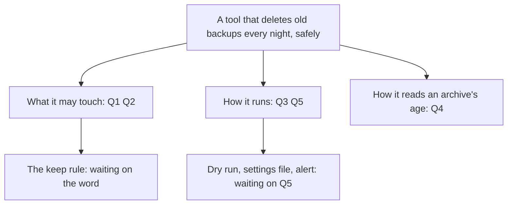
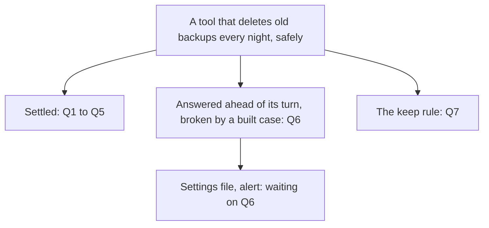
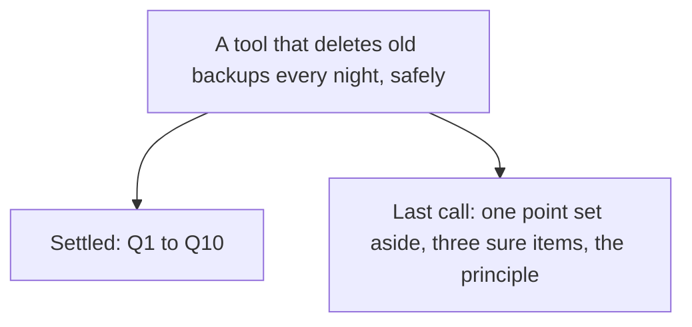

# A sample session

The user wants a small tool that deletes old database backups from a bucket. They say it will run every night with nobody watching, and they mention a dry-run switch, a settings file and a Slack alert. The session's example is one night's run: at 03:00 the job finds 40 archives older than the rule allows.

## Round one

**What I checked**

- `scripts/backup.sh` writes one archive per night to `s3://acme-backups/db/`, named by date. There are 412, the oldest 14 months old.
- The bucket has versioning on, so a delete leaves a version that can be restored for 30 days.
- Three hand-made files sit in the bucket's root, outside `db/`.
- Not checked: where the nightly job would run. The repo has no scheduler settings.

**New words**

| Word | Where it comes from | What it means | Alternatives |
|---|---|---|---|
| Keep rule | me | which backups stay: the last N daily ones, and one per month before that | Retention rule, Pruning policy |

The questions about the rule itself wait for your yes to the word.

0 settled · 5 open · 2 waiting · 0 set aside

**Sure: any objection?**

- **Q1. It touches only the dated archives under `db/`.** `backup.sh` writes nothing else there, and the three hand-made files in the root stay out of reach.
- **Q2. A delete can be undone for 30 days.** Versioning is already on, so the tool adds no trash folder of its own.
- **Q3. No step waits for a person.** You said nobody is watching, so every safety is a limit the tool checks by itself.

---

**Q4. An archive's age is the date in its name, not the time it was uploaded.**

- Example: an archive restored and uploaded again last week carries last week's upload time, and a date from March in its name.
- Recommended (leaning): the name. `backup.sh` sets it, and an upload time changes whenever a file is copied.
- Would flip it: you sometimes rename archives by hand.

---

**Q5. Where the nightly job lives** (coin flip)

- A: the CI scheduler you already use. Costs a delete key stored in CI; the logs are easy to find.
- B: a cron entry on the backup host. Costs one more thing only that host knows; no key leaves it.

Forced: A.

What a yes starts: a key with delete rights is created for the place you pick.

**Waiting:** the keep rule (on the word); dry run, the settings file and the alert (on Q5).

**Set aside:** nothing.

## Round two, after "the word is fine, no objection, 4 yes, 5 A, dry run is the default and the nightly job is the plain command, and keep the auditors' monthly archives in mind"

**New words:** none

5 settled · 2 open · 1 waiting · 1 set aside

**Q6. Dry run is the default, and the nightly job is the plain command.** You answered this ahead of its turn, and the two halves break on Q3.

- Example: the 03:00 job runs the plain command, which is a dry run, so it only prints the 40 archives it would delete. Every night, for good.
- Recommended (leaning): dry run is the default at a terminal, and the scheduled job passes `--apply`.
- Would flip it: you want the first weeks of nightly runs to delete nothing, on purpose.

---

**Q7. The keep rule: the last 30 daily archives, and the first of each month before that.**

- Example: of the 412 archives, 30 daily and 13 monthly ones stay, and 369 go on the first run.
- Recommended (leaning): yes, with the two numbers in the settings file.
- Would flip it: the auditors need more than one archive per month.
- Reviewer: "Nothing says what happens when listing the bucket fails halfway. The rule would see fewer archives than exist and could delete the newest ones it does see."

**Waiting:** the settings file and the alert (on Q6).

**Set aside:** the auditors' monthly archives.

## The close

Nothing is open or waiting. Three things need your word.

10 settled · 0 open · 0 waiting · 1 set aside

**1. Set aside**

- The auditors' monthly archives. Q7 keeps the first of each month for good, which covers it. Dropped, unless you say otherwise.

**2. Last call: settled by no objection**

- Q1. It touches only the dated archives under `db/`.
- Q2. A delete can be undone for 30 days, through the bucket's versioning.
- Q3. No step waits for a person.

**3. Q11. The principle**

- Proposed: "The tool deletes an archive only when the keep rule does not keep it and the bucket was listed in full."
- Built cases it survives: a listing that fails halfway (nothing is deleted); a hand-made file in the root (the tool looks only under `db/`, by Q1); a first run with 369 archives to delete (allowed, and the alert says so).
- A first draft broke: "it never deletes an archive newer than 30 days" met an archive whose name carries the wrong date.
- Recommended (leaning): this sentence.
- Would flip it: you want the 30-day undo named in it.

After the answers:

🔥 Grilled: 11 settled · 0 open · 0 set aside
